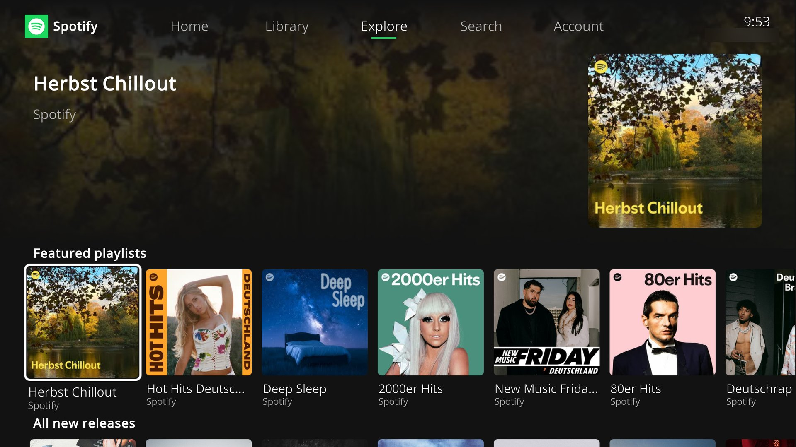
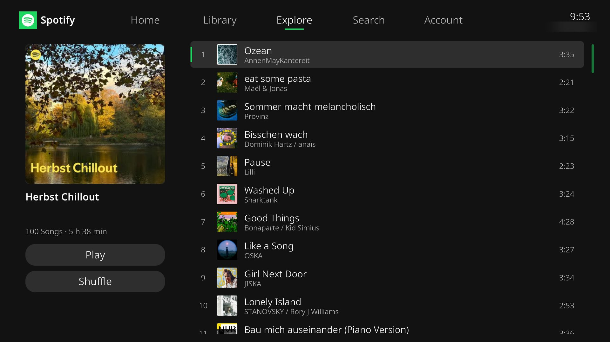
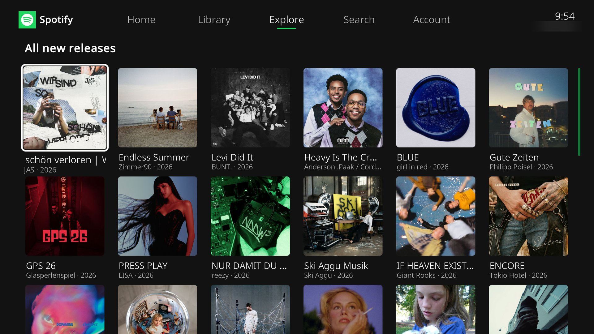
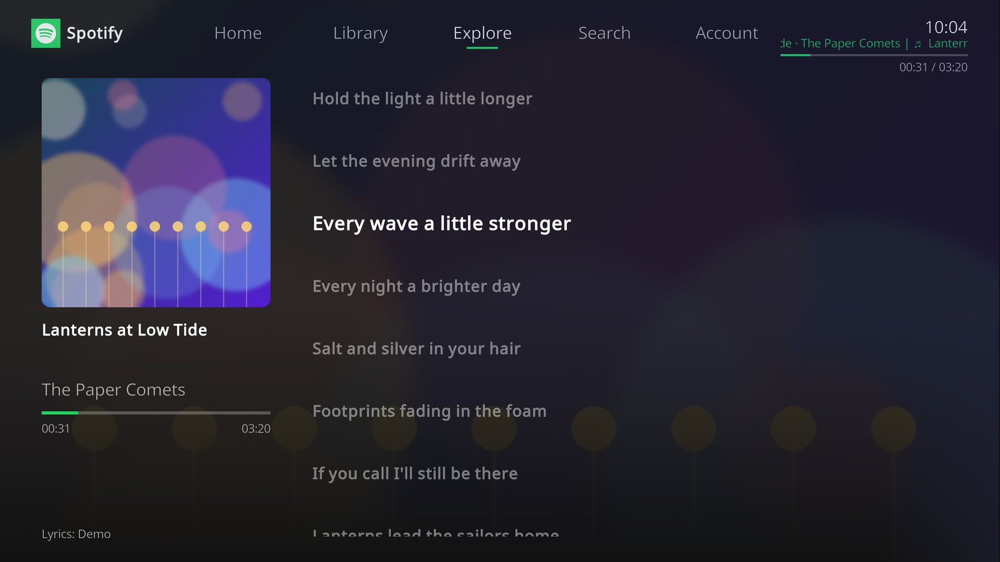

# plugin.audio.spotify
Unofficial spotify plugin for Kodi, (for now) not yet available in the official Kodi repo.

> **This fork** adds a TV interface for remote controls with time-synced lyrics, much faster loading (caching,
> preloading of playlists, optional own Spotify client ID) and fixes for audio streaming and
> for Kodi on Windows (Python 3.8). It is based on version 1.3.14 of
> [glk1001/plugin.audio.spotify](https://github.com/glk1001/plugin.audio.spotify). The later
> upstream "developer client_id" option, which replaces the built-in client ID, is not
> included: since Spotify's
> [February 2026 changes](https://developer.spotify.com/documentation/web-api/references/changes/february-2026),
> new apps get many playlists empty. Here your own client ID is used in addition instead.
>
> **Installation:** download the zip of the latest
> [release](https://github.com/Feenichs/plugin.audio.spotify/releases), then in Kodi enable
> *Settings → System → Add-ons → Unknown sources* and use
> *Add-ons → Install from zip file*. Restart Kodi after an update, Kodi only loads the texts
> of an add-on once.

Uses 'bottle' and 'librespot - spotty' for playback, and 'spotipy' for the playlist, albums, etc. menus.

Thanks to mherger for creating the special ['spotty'](https://github.com/michaelherger/librespot) branch forked off librespot.

This a fork of the [marcelveldt](https://github.com/marcelveldt) version, modified to work with Kodi 19 and 20.
Thanks to Ldsz, Elkropac, and FernetMenta for getting it to work with Python 3.9+.

## TV interface
When the add-on is opened, a full-screen interface with tabs (Home, Library, Explore, Search,
Account) and rows of tiles is shown, made for remote controls. Albums and playlists open as a
track list with play and shuffle buttons, artists as a page with their top tracks, albums and
singles. The context menu (`C` / long press) offers play, shuffle, add to queue and the actions
of the classic menu. The classic menu is available on the Account tab.

It can be opened with `RunScript(plugin.audio.spotify,home)` and configured in the add-on
settings ("TV interface"). The skin files are generated by `.scripts/generate_home_window.py`.

## Lyrics
While a track is playing, press `Info` (or choose *Show lyrics* in the context menu) to show
its lyrics, time-synced like in the Spotify app where available. The lyrics come from
[LRCLIB](https://lrclib.net) and, as a fallback without timing, [lyrics.ovh](https://lyrics.ovh);
Spotify's own lyrics are only available through an internal API. Title, artist, album and
duration of the playing track are sent to these services; this can be turned off in the
settings ("Load lyrics from the internet").

## Faster loading with your own Spotify client ID
Spotify limits requests per app, and the add-on's built-in client ID is shared by all
users, so requests are often delayed by 15–20 seconds. You can add your own (free) client
ID in the add-on settings; the built-in one is still used for everything your own app may
not access. See [docs/own-client-id.md](docs/own-client-id.md).

## Support
Create issue in Github.
