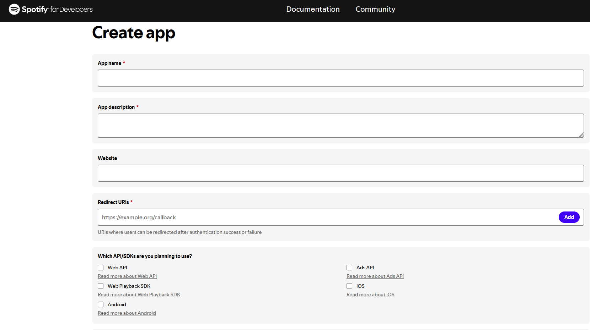

# Using your own Spotify client ID

## Why

Spotify limits the number of Web API requests per app ("client ID"), counted in a
rolling 30 second window. By default, the add-on uses one built-in client ID that is
shared by all its users. That shared limit is often used up. Spotify then makes requests
wait, usually 15–20 seconds, and menus and playlists load slowly.

With your own client ID, only your own requests count towards the limit. The add-on uses
your client ID **in addition** to the built-in one.

New apps run in Spotify's *development mode*, which since
[February 2026](https://developer.spotify.com/documentation/web-api/references/changes/february-2026)
may only use part of the Web API. So the add-on uses your client ID for:

- your own playlists (listing them and their tracks),
- your saved songs and albums, your followed artists,
- your top tracks and top artists,
- albums and the albums of an artist.

Everything else uses the built-in client ID: Spotify's own playlists (mixes, radios,
"This Is …") and playlists of other users, featured playlists, new releases, categories,
search, saving and following. If Spotify refuses a request with your client ID, the
add-on repeats it with the built-in one. So nothing stops working.

It is free and takes about five minutes. You need a Spotify account; Spotify may require
Premium for apps in development mode.

## 1. Create a Spotify app

1. Open the [Spotify Developer Dashboard](https://developer.spotify.com/dashboard) and log
   in with your Spotify account. Accept the developer terms if asked.
2. Click **Create app**. You get this form:

   

3. Fill it in like this:

   | Field | What to enter |
   |---|---|
   | **App name** | Any name, e.g. `Kodi Spotify` |
   | **App description** | Any text, e.g. `Spotify add-on for my Kodi` |
   | **Website** | Leave empty |
   | **Redirect URIs** | Type `http://127.0.0.1:8888/callback` and click **Add** next to the field. The add-on does not use it, but the form cannot be saved without one. Spotify no longer accepts `localhost`; use `127.0.0.1`. |
   | **Which API/SDKs are you planning to use?** | Tick **Web API** only, leave all other boxes empty |

4. Below the form, tick the checkbox to accept Spotify's terms and click **Save**.

## 2. Copy the client ID

1. After saving, your new app opens. Click **Settings** (top right).
2. Copy the **Client ID**, a 32 character code like `1a2b3c4d5e6f…`.
   You do **not** need the client secret, so there is no need to click
   **View client secret**. Never share the secret.

## 3. Allow your Spotify account (if needed)

Apps start in *development mode*, in which only allowed users may use them. The account
that created the app is normally allowed. If the add-on log says your own client ID was
refused for everything (see [Check that it works](#5-check-that-it-works)), open
**Settings → User Management** in your app and add the name and e-mail address of the
Spotify account you use in Kodi.

## 4. Enter the client ID in Kodi

1. In Kodi, open the add-on settings of **Spotify** (*Add-ons → My add-ons → Music
   add-ons → Spotify → Configure*).
2. In the first category, enter the client ID under
   **Own Spotify client ID (optional, reduces waiting times)**.
3. Click **OK**.

The add-on service picks up the change within a few seconds and requests a token for
your client ID. There is no need to restart Kodi or to sign in again.

To go back to the built-in client ID only, clear the field.

## 5. Check that it works

Look at the Kodi log (`kodi.log`; on LibreELEC `/storage/.kodi/temp/kodi.log`):

- `Retrieved Spotify auth token for the own client id.` means your client ID is used.
- `Could not get an auth token for the own client id.` means the token request failed.
  Check that you copied the client ID (not the secret) completely, then see step 3.
- `… failed with the own client id (403), using the shared client id.` is normal for
  playlists of other users. If it appears for *every* request, your account is probably
  not allowed in the app (step 3).
- `Your application has reached a rate/request limit` should appear less often. It can
  still appear for the requests that always use the built-in client ID (see above).

## Notes

- Your client ID is stored only in the add-on settings on your Kodi device.
- The add-on still signs in with your Spotify account as before. The client ID only
  decides which app's request limit is used.
- Playlists are also preloaded in the background, the most opened first, so that they
  open without waiting. This can be turned off with
  **Preload playlists in the background** in the same settings category.
